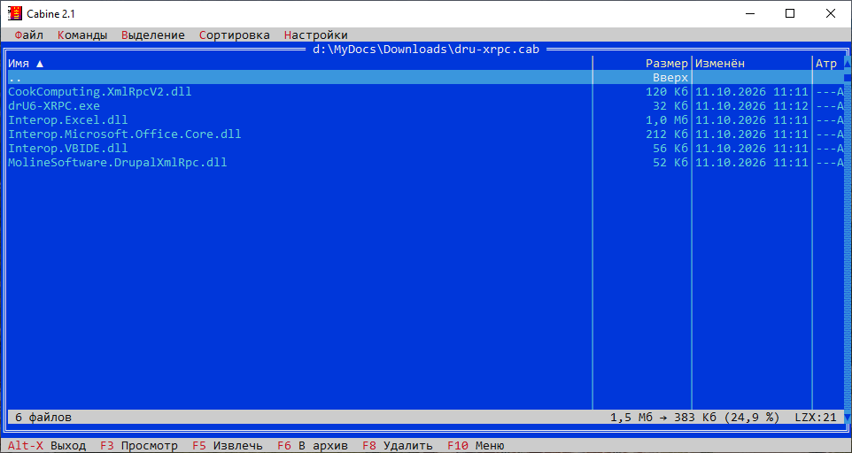

# Cabine

CAB-архиватор и файловый менеджер на [Turbo Vision](https://github.com/magiblot/tvision) (порт magiblot,
подключён субмодулем `tvision`), работа с CAB — через системный Cabinet API Windows
(FCI/FDI, `cabinet.dll`). Архивы ZIP и RAR просматриваются и распаковываются с помощью
[minizip-ng](https://github.com/zlib-ng/minizip-ng) и UnRAR, архивы 7Z — с помощью
LZMA SDK из [7-Zip](https://github.com/ip7z/7zip), архивы GZ, TAR и TAR.GZ — с помощью
zlib и собственного разбора tar (см. «Сторонние библиотеки»).



## Возможности

- Одна панель, как в файловом менеджере: директории на диске и директории внутри
  CAB-архива просматриваются одинаково. Enter на архиве открывает его, первая строка `..`
  ведёт вверх; из корня архива — обратно на диск, курсор встаёт на сам архив.
- При запуске открывается то место, на котором программу закрыли, в том числе
  директория внутри архива.
- Директории архива выводятся из путей файлов; для директории показываются суммарный
  размер и самая поздняя дата.
- Размеры показываются в удобном виде: Б, Кб, Мб, Гб (сортировка — по точному размеру).
- «Настройки» → «Параметры»: ассоциация файлов `.cab`, `.zip`, `.rar`, `.7z` с Cabine (каждое
  расширение — своей галочкой) и `.tar`, `.tgz`, `.gz` (одной галочкой), показ архивов
  выше остальных файлов, степень сжатия новых архивов, редактор для F4 (vim,
  Notepad++ или Блокнот).
- F4 открывает файл в редакторе (по умолчанию vim из `PATH`); файл из архива
  извлекается во временную директорию, после правки в vim предлагается обновить
  его в архиве.
- Сортировка по имени, типу, дате и размеру (щелчком по заголовку колонки или из меню);
  имена сравниваются «естественно»: `file2` идёт раньше `file10`. Директории всегда
  выше файлов.
- Пометка файлов и директорий в стиле Norton Commander: Ins, пробел, правая кнопка мыши,
  выделение и снятие выделения по маске (`*.txt;*.doc`), инверсия.
- Внутри архива: извлечение помеченных файлов и директорий (пути строятся относительно
  текущей директории архива) или всего архива; добавление файлов в текущую директорию
  архива; удаление файлов и директорий; при совпадении имён — запрос «Да / Да для всех /
  Нет / Нет для всех / Отмена» либо заданный режим.
- На диске: Alt+A помещает помеченные файлы и директории в новый или существующий архив
  (путь архива задаётся в окне с кнопкой «Обзор...»), Alt+E распаковывает помеченные архивы, F8 удаляет файлы и директории в корзину,
  Alt+T и Alt+I работают с архивом под курсором.
- Командная строка и контекстное меню Проводника: добавление выделенных файлов и
  директорий в архив с сохранением структуры, распаковка архива в его же директорию
  или в поддиректорию с именем архива.
- Архивы ZIP и RAR: просмотр содержимого, просмотр файлов (F3), проверка, распаковка
  (в том числе из Проводника). Изменять ZIP и RAR нельзя — они открываются только для
  чтения. Поддерживаются ZIP64, пароли ZIP (PKWARE и WinZip AES), RAR4 и RAR5, solid- и
  многотомные RAR, пароли RAR, в том числе с зашифрованными заголовками. Пароль
  спрашивается при необходимости и запоминается для архива до выхода из программы.
- Архивы 7Z — так же, только для чтения: LZMA, LZMA2, PPMd, фильтры BCJ/BCJ2/ARM и
  другие, Delta, solid-архивы. Архивы 7z с паролем не поддерживаются — выводится
  сообщение об этом.
- Архивы GZ, TAR и TAR.GZ (`.tgz`) — так же, только для чтения. TAR читается в форматах
  ustar, GNU (длинные имена) и pax (имена в UTF-8, большие размеры); `.gz` с одним файлом
  показывается как архив из этого файла (имя — из заголовка gzip или имя архива без `.gz`).
- Степень сжатия CAB выбирается из выпадающего списка: «Без сжатия», «Быстрое (MSZIP)»,
  «Обычное (LZX:15)», «Хорошее (LZX:18)», «Максимальное (LZX:21)» — по умолчанию
  максимальное. Число у LZX — размер окна сжатия (2^15 … 2^21 байт): чем больше окно,
  тем лучше сжатие и тем больше памяти нужно при упаковке и распаковке.
- Многотомные архивы: в окне создания архива задаётся «Размер тома» (готовые значения в
  списке — 1,44 Мб, 100 Мб, 650 Мб, 700 Мб, 1 Гб, 2 Гб — или своё, от 64 Кб). Тома
  называются `<имя>.cab`, `<имя>2.cab`, `<имя>3.cab`…
- Самораспаковывающиеся архивы (EXE): при создании нового архива достаточно отметить
  «Создать самораспаковывающийся архив». Распаковщик тоже построен на Turbo Vision
  (см. ниже). Самораспаковывающийся архив может быть и многотомным.
- Проверка целостности (полная распаковка без записи на диск).
- Просмотр (F3): сначала проверяется, не архив ли это — по содержимому (сигнатуры
  `MSCF`, `PK`, `Rar!`, `7z`, gzip, заголовок tar), а не по расширению. Архив открывается в панели как директория,
  любой другой файл — во встроенном просмотрщике как текст, с автоопределением
  кодировки и переключением UTF-8 / Windows-1251 / DOS-866 по F8.
- Открытие (Enter): архив (тоже по содержимому) открывается в панели, остальные
  файлы — сопоставленной программой. Вложенный архив открывается в панели как
  директория (только для чтения).
- После извлечения итоговое окно не показывается: панель сразу доступна,
  сообщения выводятся только об ошибках.
- Переход на другие диски — строки `[C:]`, `[D:]` в корне диска.
- Окно хода длительных операций с кнопкой «Отмена» (также Esc, Enter или пробел);
  прерывание — после подтверждения.
- Русский интерфейс, включая стандартные окна сообщений; горячие клавиши с русскими
  буквами (Alt+Ф открывает меню «Файл» и т. д.).
- Пути и имена файлов в Юникоде: кириллические имена сохраняются в архиве в UTF-8 и
  корректно читаются системными утилитами (`expand.exe`).

## Требования

- Windows 10 или новее.
- Visual Studio 2022 (компилятор MSVC) и Windows SDK.
- CMake 3.16 или новее.
- Git (библиотеки подключены субмодулями).

## Сборка

Библиотеки подключены git-субмодулями — ссылками на определённые коммиты:

| Субмодуль | Репозиторий | Назначение |
|---|---|---|
| `tvision` | [magiblot/tvision](https://github.com/magiblot/tvision) | Интерфейс |
| `third_party/zlib` | [madler/zlib](https://github.com/madler/zlib) | Deflate для ZIP |
| `third_party/minizip-ng` | [zlib-ng/minizip-ng](https://github.com/zlib-ng/minizip-ng) | Чтение ZIP |
| `third_party/unrar` | [aawc/unrar](https://github.com/aawc/unrar) (копия исходников UnRAR с rarlab.com) | Чтение RAR |
| `third_party/7zip` | [ip7z/7zip](https://github.com/ip7z/7zip) (официальный репозиторий 7-Zip; используется LZMA SDK из `C`) | Чтение 7Z |

Клонировать проект необходимо вместе с субмодулями:

```bash
git clone --recursive https://github.com/roosslan/cabarc_tvision.git
```

Если репозиторий уже склонирован без субмодулей, их необходимо подтянуть:

```bash
git submodule update --init
```

Сборка:

```bash
cmake -S . -B build -G "Visual Studio 17 2022" -A x64
```

```bash
cmake --build build --config Release
```

Результат — `build\Release\cabine.exe` и `build\Release\cabine-shell.exe` (посредник
для контекстного меню Проводника, должен лежать рядом с `cabine.exe`). Попутно
собирается `cabine-sfx.exe` — распаковщик самораспаковывающихся архивов; он
встраивается в `cabine.exe` ресурсом, и отдельно его распространять не нужно. Исполняемые
файлы собираются со статической библиотекой времени выполнения и не требуют установки
VC++ Redistributable.

Субмодуль закреплён на версии Turbo Vision весны 2021 года, с которой Cabine проверен:
Cabine подменяет файл строк библиотеки и обходит ошибки именно этой версии (см. ниже).
Чтобы собрать с другой копией Turbo Vision, путь к ней необходимо указать при
конфигурировании: `-DTV_ROOT=<путь>`.

### Тесты

Тесты ядра (`tests/enginetest.cpp`) проверяют без интерфейса работу с CAB: создание и
распаковку всеми методами сжатия, кириллические имена и вложенные пути, режимы
распаковки и отмену, добавление и удаление файлов, самораспаковывающиеся архивы,
многотомные архивы (в том числе самораспаковывающийся первый том и недостающий том),
чтение созданных архивов системным `expand.exe`; ZIP (создаётся в тесте: Deflate,
пароли PKWARE и AES, имена в OEM) и RAR (образцы в `tests/data`: solid RAR5, пароль,
шифрованные заголовки, многотомный архив); TAR, TAR.GZ и GZ (создаются в тесте:
длинные имена GNU, заголовки pax, повреждённый gzip, а также архив системного `tar.exe`);
7Z (образцы в `tests/data`: solid LZMA2, BCJ, Delta, архивы с паролем), а также
форматирование и разбор размеров и работу с путями.

Тесты интерфейса (`tests/ui`) запускают настоящий `cabine.exe` в псевдоконсоли (ConPTY):
драйвер `cabine-uidriver` по сценарию нажимает клавиши, ждёт текст на экране и
делает снимки экрана, а скрипт `tests/ui/run.ps1` готовит данные и проверяет результат
(распакованные файлы, созданные архивы). Сценарии `tests/ui/scenarios/*.scn` покрывают
навигацию по панели и восстановление места при запуске, операции внутри архива и на
диске, пакетный режим (`-a`, `-x`, `-e`, `-ei`, `-ai`), самораспаковывающиеся и
многотомные архивы, ZIP, RAR с паролем, 7Z, TAR.GZ, окно «Параметры», путь без кавычек
и запуск программы из архива. Тесты работают в отдельной временной директории и с
отдельными настройками (переменная `CABINE_SETTINGS_DIR`), настройки пользователя не
затрагиваются. Во время прогона на экране может появиться окно консоли запускаемой из
архива программы.

Все тесты собираются вместе с программой (отключаются параметром `-DCABINE_TESTS=OFF`)
и запускаются так:

```bash
ctest --test-dir build -C Release --output-on-failure
```

Только тесты интерфейса, с сохранением рабочей директории для разбора:

```bash
powershell -ExecutionPolicy Bypass -File tests\ui\run.ps1 -Bin build\Release -Keep
```

### Непрерывная интеграция и релизы

GitHub Actions (`.github/workflows/build.yml`) собирает программу и запускает тесты
на каждый push в `trunk` и на каждый pull request. Собранный пакет сохраняется как
артефакт сборки.

Для выпуска релиза необходимо поднять версию в `src/version.h`, закоммитить и
отправить тег с тем же номером:

```bash
git tag v2.3
```

```bash
git push origin v2.3
```

Workflow проверяет, что тег совпадает с версией в `src/version.h`, собирает и тестирует
программу и создаёт на GitHub релиз с CAB-архивом `cabine-<версия>-x64.cab` (LZX:21,
создаётся системным `makecab.exe`; внутри — директория `cabine-<версия>-x64` с
`cabine.exe`, `cabine-shell.exe` и README) и его контрольной суммой SHA-256.

## Запуск

| Команда | Действие |
|---|---|
| `cabine.exe` | Панель на том месте, где программу закрыли |
| `cabine.exe <директория \| архив>` | Панель в указанном месте |
| `cabine.exe -a <путь> [<путь>...]` | Добавить файлы и директории в архив и завершиться |
| `cabine.exe -ai <путь> [<путь>...]` | То же, но имя архива предлагается в окне, где его можно изменить |
| `cabine.exe -x <архив> [<архив>...]` | Распаковать архивы (CAB, ZIP, RAR) и завершиться |
| `cabine.exe -e <архив> [<архив>...]` | Распаковать каждый архив в поддиректорию с его именем и завершиться |
| `cabine.exe -ei <архив> [<архив>...]` | Распаковать в директорию, которая предлагается в окне |
| `cabine.exe --register` | Добавить пункты в контекстное меню Проводника и директорию программы в `Path` пользователя |
| `cabine.exe --unregister` | Убрать пункты из контекстного меню Проводника и директорию из `Path` |
| `cabine.exe --help` | Справка по параметрам |

Вместо пути можно указать `@<файл>` — список путей в UTF-8, по одному в строке
(файл удаляется после чтения). Путь с пробелами, переданный без кавычек
(`cabine.exe D:\dru-xrpc (1).cab`), Windows делит на части; Cabine склеивает их обратно,
пока не получится существующий файл или директория.

**Добавление (`-a`, `-ai`).** Директории добавляются со всем содержимым, с сохранением
структуры: `-a D:\Проект` даёт в архиве `Проект\src\main.cpp` и т. д. Архив создаётся
рядом с первым объектом: для одного объекта — `<имя>.cab` (для файла — без его
расширения), для нескольких — по имени директории, в которой они лежат. Если такой
архив уже существует, файлы добавляются в него, одноимённые заменяются; если имя занято
другим файлом, выбирается `<имя> (2).cab` и т. д. Степень сжатия — из окна
«Настройки» → «Параметры». С `-ai` сначала показывается окно «Добавить в архив»:
имя архива (строка пути и кнопка «Обзор...»), степень сжатия, размер тома и галочка
«Создать самораспаковывающийся архив (EXE)». Существующий CAB дополняется; многотомный
и самораспаковывающийся архивы создаются только новыми. Имя с расширением `.exe` тоже
создаёт самораспаковывающийся архив.

**Распаковка (`-x`, `-e`, `-ei`).** С `-x` архив распаковывается в ту же директорию, где он
лежит, с `-e` — в поддиректорию с именем архива без расширения (`D:\Отчёт.zip` —
в `D:\Отчёт\`). С `-ei` сначала появляется окно «Извлечь» со строкой пути и кнопкой
«Обзор...»: для одного архива в нём предложена поддиректория с его именем, для
нескольких — директория, где лежит первый архив (каждый архив распаковывается в свою
поддиректорию внутри выбранной). Пути сохраняются; при совпадении имён выводится запрос на замену,
для зашифрованного архива — запрос пароля.

Во всех режимах (в том числе при вызове из контекстного меню Проводника) на экране
только окно хода выполнения Turbo Vision: этап, текущий файл, полоса прогресса и
кнопка «Отмена» (также Esc). Прерывание выполняется после подтверждения; недописанный
архив не остаётся. После успешного завершения на полсекунды показывается «Готово»
и программа закрывается.

Окно консоли желательно не уже 80 колонок.

### Контекстное меню Проводника

Для установки пунктов меню необходимо выполнить:

```bash
cabine.exe --register
```

В контекстном меню всех файлов и директорий появляется подменю «Cabine»:

- у файлов `.cab`, `.zip`, `.rar`, `.7z`, `.gz` (в том числе `.tar.gz`), `.tgz`, `.tar` —
  «Открыть в Cabine», «Распаковать здесь»,
  «Извлечь в ...», «Добавить в CAB-архив», «Добавить в архив ...»;
- у остальных файлов и директорий — «Добавить в CAB-архив», «Добавить в архив ...».

«Добавить в CAB-архив» сразу создаёт `<имя>.cab` рядом с выделенным (как `-a`).
Пункты с многоточием сначала показывают окно Turbo Vision с предложенным путём и
кнопкой «Обзор...»: «Извлечь в ...» — директорию с именем архива (`-ei`; у `.tar.gz`
снимается всё расширение: `src.tar.gz` — в `src\`), «Добавить в архив ...» — имя
архива (`-ai`).

Подменю записывается в `HKCU\Software\Classes\AllFilesystemObjects\shell\Cabine`
текущего пользователя, права администратора не нужны. Пункты для архивов показываются
по условию `AppliesTo` только у файлов архивов; «Открыть в Cabine» —
только при выделении одного файла.

Команды пунктов указывают на место, откуда была выполнена регистрация; после переноса
программы регистрацию необходимо повторить. Повторная регистрация заменяет и пункты
прежних версий (отдельные, без подменю). Удаление — `cabine.exe --unregister`.

Вместе с пунктами меню директория программы добавляется в переменную `Path`
текущего пользователя (`HKCU\Environment`): в новых окнах консоли `cabine` запускается
по имени. `--unregister` убирает её из `Path`.

Проводник запускает команду пункта меню отдельно для каждого выделенного объекта
(до 100 объектов). Поэтому пункты вызывают `cabine-shell.exe`: первый экземпляр
принимает пути от остальных через именованный канал, дожидается паузы и один раз
запускает `cabine.exe` со всем списком. У `cabine-shell.exe` нет окна, консоль
появляется только одна.

### Самораспаковывающийся архив

Галочка «Создать самораспаковывающийся архив (EXE)» есть в окне создания нового
архива (Alt+A на диске и «Файл» → «Новый архив»); если имя архива задано с расширением
`.exe`, она отмечена заранее. Вместо `<имя>.cab` создаётся `<имя>.exe`.

Галочка сразу меняет расширение в имени архива: отмеченная — `.cab` на `.exe`, снятая —
обратно `.exe` на `.cab`. В окне «Добавить в архив ...» меняется строка пути, в окне
«Новый архив» — строка «Будет создан». Если файл с новым именем уже есть, перед
созданием архива программа спросит, заменять ли его.

Вместе с «Размером тома» получается многотомный самораспаковывающийся архив: первый
том — `<имя>.exe` (распаковщик и начало архива), остальные — обычные `<имя>2.cab`,
`<имя>3.cab`… Первый том вместе с распаковщиком укладывается в размер тома; если том
меньше самого распаковщика (около 600 Кб), в первый том попадает минимальная часть
архива (64 Кб). Все тома должны лежать в одной директории с EXE; если тома не хватает,
распаковщик называет его.

Такой файл — это программа-распаковщик `cabine-sfx.exe`, сразу за которой дописан
обычный CAB-архив. Распаковщик находит архив по заголовку PE: конец последней секции
образа программы — начало архива, там же проверяется сигнатура `MSCF`. Распаковка
идёт через FDI так же, как в Cabine, со сдвигом позиций на начало архива.

При запуске распаковщик показывает окно Turbo Vision: имя архива, число файлов и
их размер, поле «Распаковать в» (по умолчанию — директория, где лежит EXE) с кнопкой
«Обзор», режим для существующих файлов и сохранение путей. Затем выводится окно хода
с кнопкой «Отмена», после завершения — «Готово», и программа закрывается. Код
возврата: 0 — успешно, 1 — ошибка, 2 — отказ от распаковки.

Cabine открывает самораспаковывающиеся архивы как обычные: F3 на диске, Ctrl+O или
параметр командной строки показывают содержимое в панели (Enter такой файл
запускает). Добавление и удаление файлов в таком архиве сохраняют распаковщик.

## Управление

| Клавиша | Действие |
|---|---|
| Enter, двойной щелчок | Войти в директорию или архив; открыть файл сопоставленной программой |
| Backspace, Ctrl+PgUp | Перейти вверх |
| F3 | Просмотр: архив — в панели, остальное — как текст |
| F4 | Редактировать в выбранном редакторе (в архиве — с обновлением архива) |
| Alt+E | Извлечь (в архиве — помеченное; на диске — помеченные архивы) |
| Alt+A | В архив (в архиве — добавить файлы; на диске — упаковать помеченное) |
| F8, Del | Удалить (в архиве — из архива; на диске — в корзину), в том числе директории |
| Shift+F6, F2 | Переименовать файл или директорию на диске |
| Ctrl+N | Новый архив |
| Ctrl+O | Открыть архив через диалог |
| Alt+T | Проверить архив |
| Alt+I | Свойства архива |
| Ctrl+R | Перечитать |
| Ins, пробел, правая кнопка мыши | Пометить файл или директорию |
| Ctrl+A | Выделить всё |
| `+` / `-` | Выделить / снять выделение по маске |
| `*` | Инвертировать выделение |
| Ctrl+F3 … Ctrl+F7 | Сортировка: имя, тип, дата, размер, без сортировки |
| Esc, Alt+F3 | Закрыть просмотр |
| F9 | Меню |
| Alt+X | Выход |

Повторный выбор того же способа сортировки меняет её направление. Если ничего
не помечено, команды применяются к строке под курсором; Alt+E внутри архива с курсором
на `..` извлекает всё содержимое текущей директории архива.

## Особенности и ограничения

- Формат CAB не допускает изменения на месте. Добавление и удаление файлов выполняются
  пересборкой: оставшиеся файлы распаковываются во временную директорию и сжимаются
  заново вместе с новыми. Архив записывается во временный файл рядом с исходным и
  заменяет его только при успешном завершении.
- Многотомные архивы создаются, читаются и распаковываются; следующие тома должны лежать
  в той же директории. Открытый первый том показывает файлы всех томов; если тома не
  хватает, свойства архива (Alt+I) называют его, а распаковка завершается ошибкой.
  Изменять многотомные архивы (добавлять и удалять файлы) нельзя. Каждый том, как и
  обычный архив, — не больше 2 Гб.
- Ограничения формата: файл в архиве — до 2 Гб, не более 65535 файлов. В списке
  отображаются первые 32767 файлов (ограничение `TListViewer`), операции над архивом
  затрагивают все файлы.
- Реализация LZX в системной `cabinet.dll` на сильно повторяющихся данных (например,
  журналах из однотипных строк) работает крайне медленно — минуты на десятки мегабайт.
  На таких данных предпочтительнее MSZIP; длительную операцию можно прервать по Esc.
- Имена с символами вне ASCII записываются в UTF-8 с флагом `_A_NAME_IS_UTF`. Имена в
  архивах без этого флага читаются в кодировке ANSI системы.
- Встроенный просмотр открывает файлы размером до 16 Мб.
- Файлы для просмотра и открытия извлекаются в `%TEMP%\Cabine-*`; директория удаляется
  при выходе. Изменения, сделанные во внешней программе, в архив не возвращаются.
  Для программ (`.exe`, `.com`, `.bat`, `.cmd`, `.msi`) извлекается весь архив с путями,
  и программа запускается из своей директории: ей доступны соседние файлы (DLL, данные,
  внешние CAB установщика). Временная директория удаляется при выходе из Cabine, поэтому
  запущенную программу лучше завершить раньше.
- Вложенный архив распаковывается во временную директорию и открывается только для
  чтения: изменения в нём не попали бы в родительский архив.
- Удаление на диске выполняется в корзину. Если корзины у диска нет (сетевые и съёмные
  диски) или она отключена в своих свойствах, вопрос перед удалением предупреждает, что
  удаление безвозвратное. Объект больше максимального размера корзины Windows
  удаляется безвозвратно без отдельного предупреждения.
- Переименование файла или директории на диске — Shift+F6 или F2; внутри архива
  переименование не поддерживается. Копирование файлов не поддерживается.
- Пустые директории в формате CAB не хранятся и при добавлении пропускаются.
- Распаковщик увеличивает самораспаковывающийся архив примерно на 740 Кб.
- Степень сжатия по умолчанию — максимальная (LZX:21). На сильно повторяющихся данных
  она может быть очень медленной (см. выше про LZX); тогда стоит выбрать «Быстрое (MSZIP)».
- Настройки (степень сжатия, показ архивов первыми, положение панели) хранятся в
  `%APPDATA%\Cabine\cabine.ini` (другую директорию можно задать переменной окружения
  `CABINE_SETTINGS_DIR`). Если при выходе был открыт вложенный архив, запоминается внешний.
- Ассоциации записываются в `HKCU\Software\Classes` (ProgID `Cabine.cab`, `Cabine.zip`,
  `Cabine.rar`, `Cabine.7z`, `Cabine.tar`, `Cabine.tgz`, `Cabine.gz`) и включаются независимо друг от друга;
  прежняя программа запоминается и возвращается при снятии галочки. Если для расширения
  выбрана программа через «Открыть с помощью» → «Всегда использовать», Windows отдаёт
  приоритет этому выбору, и Cabine необходимо выбрать там же. Значок ассоциированных
  архивов — `archive.ico` (ресурс в `cabine.exe`), значок программы — `app.ico`.
- ZIP: поддерживаются методы «без сжатия», Deflate и пароли PKWARE/WinZip AES; архивы
  с методами BZip2, LZMA, Zstandard, XZ, PPMd (их создают, например, 7-Zip) открываются,
  но такие файлы не распаковываются — выводится сообщение о неподдерживаемом методе.
  Имена без флага UTF-8 читаются в кодовой странице OEM (так их пишет «Сжатая ZIP-папка»
  Windows).
- RAR: самораспаковывающиеся RAR и ZIP (EXE) не распознаются, распознаются только
  самораспаковывающиеся CAB, созданные Cabine. Многотомный RAR открывается с любого тома,
  остальные тома должны лежать рядом. Пустые директории ZIP, RAR и TAR в панели не видны,
  но воссоздаются при распаковке всего архива.
- TAR и GZ: формат tar.gz не позволяет читать отдельные файлы без распаковки всего,
  что лежит перед ними, поэтому список, просмотр и распаковка большого `.tar.gz` каждый
  раз распаковывают поток с начала. Символьные и жёсткие ссылки, файлы устройств в tar
  пропускаются; права доступа Unix не переносятся. Размер файла внутри `.gz` берётся из
  заголовка gzip, который хранит его по модулю 4 Гб: для файлов больше 4 Гб в панели
  показывается неверный размер, но распаковываются они полностью.
- 7Z: распаковщик LZMA SDK на C распаковывает solid-блок в память целиком, поэтому для
  архива с очень большим solid-блоком (гигабайты) может не хватить памяти; пока блок
  распаковывается, полоса прогресса стоит на месте, а «Отмена» срабатывает между
  файлами. Архивы с паролем (в том числе с зашифрованными заголовками) не
  поддерживаются, как и методы BZip2 и Deflate внутри 7z.

## Сторонние библиотеки

- **zlib** — лицензия zlib (также используется для GZ и TAR.GZ).
- **minizip-ng** — лицензия zlib.
- **LZMA SDK** (`third_party/7zip`, каталог `C` репозитория 7-Zip) — распаковка 7z;
  код LZMA SDK — общественное достояние (public domain), (c) Igor Pavlov.
- **UnRAR** — исходный код UnRAR, (c) Alexander Roshal. Используется без изменений
  только для распаковки. Условие лицензии UnRAR (полный текст — `third_party/unrar/license.txt`):

  > UnRAR source code may be used in any software to handle RAR archives without
  > limitations free of charge, but cannot be used to develop RAR (WinRAR) compatible
  > archiver and to re-create RAR compression algorithm, which is proprietary.
  > Distribution of modified UnRAR source code in separate form or as a part of other
  > software is permitted, provided that full text of this paragraph, starting from
  > "UnRAR source code" words, is included in license, or in documentation if license
  > is not available, and in source code comments of resulting package.

## Доработки Turbo Vision

Библиотека не изменяется: Cabine собирает её из исходников и обходит найденные
ограничения в своём коде.

- **Русские строки.** Файл `tvtext2.cpp` библиотеки заменён в сборке файлом
  `src/tvtext_ru.cpp` с переведёнными строками стандартных окон.
- **Русские горячие клавиши** (`src/hotkeys.cpp`). Turbo Vision сравнивает выделенную
  тильдой букву побайтно и не распознаёт кириллицу в UTF-8. Буква определяется по
  физической клавише (Alt+Ф — это Alt+A) или по введённому символу. Клавиши пунктов
  меню (Alt+A, Alt+E) имеют приоритет над буквами подменю.
- **Ввод кириллицы в диалогах.** Символ вне кодовой страницы 437 приходит с кодом
  клавиши `kbNoKey` (0), а `TLabel`, `TButton` и `TCluster` сравнивают код клавиши с
  `getAltCode()` своей горячей буквы, который для кириллической буквы тоже равен нулю.
  В результате метка перехватывала любую русскую букву, и ввести русский текст в поле
  было нельзя. Таким событиям назначается отдельный ненулевой код.
- **Собственный диалог выбора файлов и директорий.** `TChDirDialog` создаёт строку ввода
  на 68 байт и копирует в неё текущий путь через `strcpy`: путь длиннее 67 байт (около
  33 русских букв) портит кучу (ошибка найдена AddressSanitizer). `TFileDialog` и
  `TDirListBox` используют буферы `MAXPATH` (260 байт, около 130 русских букв) с теми
  же `strcpy`/`strcat`. Оба диалога заменены собственным на `std::string`.
- **Многострочный текст.** `TStaticText` обрезает текст до 255 байт (около 127 русских
  букв), поэтому окна сообщений и свойств используют собственный вид без ограничения
  длины с переносом по словам.
